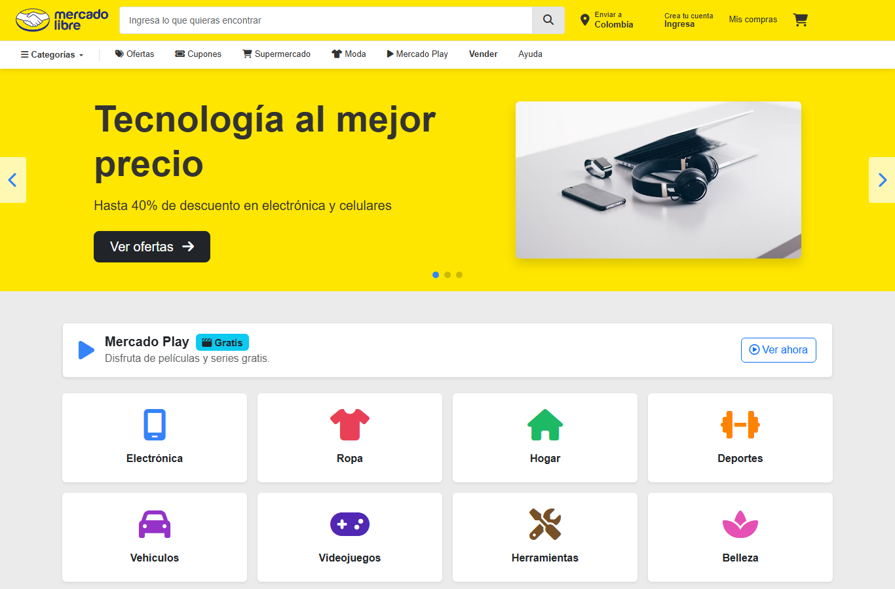
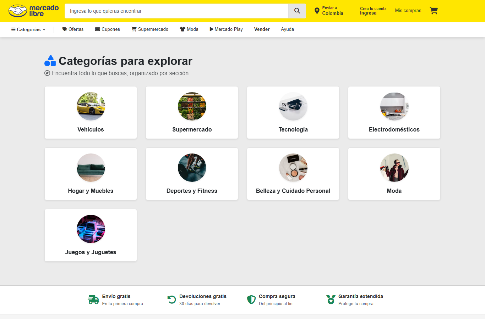
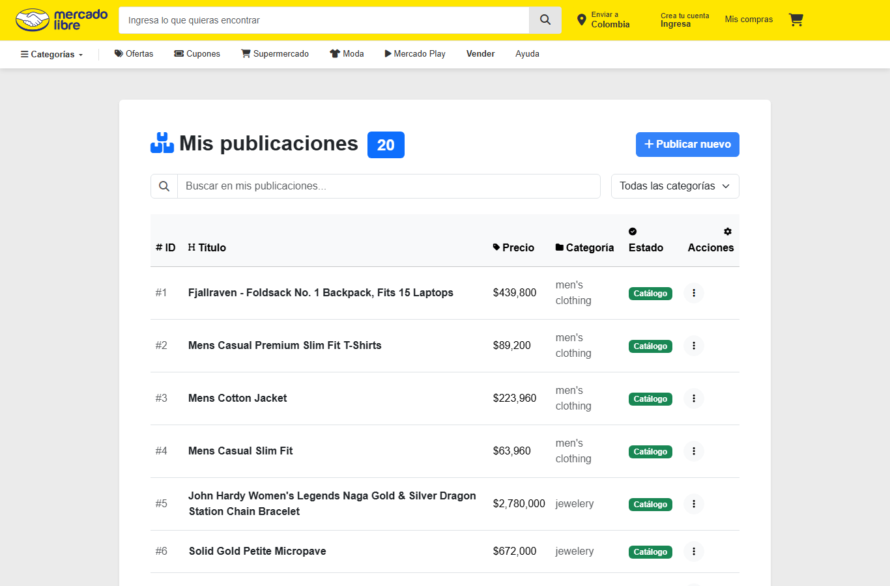

# Clon de Mercado Libre Colombia

Réplica educativa de la tienda de **Mercado Libre Colombia** hecha con **Angular 22** (proyecto con `NgModule`, sin *standalone*). Tiene catálogo de productos traído de una API, búsqueda, categorías, carrito con checkout, historial de compras, un CRUD de publicaciones y una sección de películas tipo *Mercado Play*.

Proyecto en equipo del curso Desarrollo de Sistemas de Información 3, Ingeniería de Sistemas, Universidad El Bosque.

> Proyecto con fines académicos. No está afiliado a MercadoLibre, Inc.; el logo y la marca pertenecen a sus dueños. No procesa pagos: el pedido se guarda solo en el navegador.



| Categorías | CRUD de publicaciones |
| --- | --- |
|  |  |

## Funcionalidades

- **Navbar al estilo de Mercado Libre Colombia**: logo, buscador, ubicación, menú de categorías, accesos a ofertas, Mercado Play y carrito con contador en vivo.
- **Inicio**: carrusel de banners, acceso a Mercado Play, categorías destacadas, ofertas del día y productos más buscados.
- **Búsqueda** (`/buscar?q=`): filtra el catálogo por título, categoría y descripción sin distinguir mayúsculas ni tildes. El término va en la URL, así que el enlace se puede compartir.
- **Categorías** (`/categoria`, `/categoria/:nombre`): grilla de categorías y productos de cada una.
- **Carrito** (`/carrito`): agregar y quitar productos, cambiar cantidades, resumen con envío, formulario de checkout y confirmación del pedido.
- **Mis compras** (`/mis-compras`): historial de pedidos confirmados.
- **CRUD de publicaciones** (`/listar-producto` y relacionadas): crear, listar, editar y eliminar productos, con búsqueda y filtro por categoría. Fake Store API acepta los cambios pero no los guarda, así que `ProductStoreService` los conserva en `localStorage` y los mezcla con el catálogo de la API.
- **Mercado Play** (`/mercado-play`): 12 películas con datos de OMDb (póster, sinopsis, calificación y reparto) y su tráiler de YouTube.
- **Footer** con beneficios, medios de pago, enlaces de ayuda y aviso legal.

## Tecnologías

| Tecnología | Uso |
| --- | --- |
| Angular 22 y Angular CLI | Módulos, rutas, `HttpClient` y formularios con `FormsModule` |
| TypeScript 6 y RxJS | Lógica y consumo de las APIs con observables |
| Bootstrap 5.3, Font Awesome 6 y Animate.css (por CDN) | Maquetación, iconos y animaciones |
| [Fake Store API](https://fakestoreapi.com) | Catálogo de productos |
| [OMDb API](https://www.omdbapi.com) | Fichas de las películas de Mercado Play |
| `localStorage` | Carrito, historial de pedidos y cambios del CRUD |

## Requisitos

- Node.js 22.22.3 o superior, o 24.15 o superior (probado con Node 24)
- npm 10 o superior
- Conexión a internet, por las APIs y los CDN
- Una clave gratuita de OMDb, solo si quieres ver Mercado Play

## Instalación y ejecución

```bash
git clone https://github.com/P2X4A/proyecto1-desarollo3.git
cd proyecto1-desarollo3
npm ci
npm start
```

Abre `http://localhost:4200/`.

### Clave de OMDb (opcional)

El repositorio no incluye ninguna clave. Para que Mercado Play cargue las películas:

1. Pide una clave gratuita en <https://www.omdbapi.com/apikey.aspx>.
2. Escríbela en `src/app/environments/environment.ts`, en `omdbApiKey`.
3. No la subas a Git; deja el campo vacío antes de hacer commit.

Sin clave, el resto de la tienda funciona y Mercado Play muestra un aviso.

### Build de producción

```bash
npm run build
```

Los archivos quedan en `dist/proyectoDesarollo/browser`.

## Estructura

```text
src/app/
├── environments/        # URLs base y clave de OMDb (vacía en el repositorio)
├── models/              # Producto, ítem del carrito y pedido
├── services/
│   ├── cart.service.ts  # Carrito y checkout (localStorage)
│   ├── fake-store/      # Cliente HTTP de Fake Store API
│   ├── omdb/            # Cliente HTTP de OMDb
│   ├── product-store/   # Catálogo: API + cambios locales y filtros
│   └── storage/         # Acceso tipado a localStorage
└── components/
    ├── navbarcomponent/     contenidocomponent/   buscarcomponent/
    ├── categoriascomponent/ mercadoplaycomponent/ carritocomponent/
    ├── miscomprascomponent/ footercomponent/
    └── crear-, listar-, actualizar- y eliminarproductocomponent/
```

## Equipo

El desarrollo se hizo en un repositorio anterior del equipo; aquí está la versión final.

- **Sergio Parra** ([P2X4A](https://github.com/P2X4A)): estructura del proyecto, componentes y rutas, maquetación y estilos, consumo de Fake Store API y OMDb, integración del carrito, CRUD con almacenamiento local, buscador, categorías y Mercado Play.
- **[boognuel](https://github.com/boognuel)**: filtro de productos del buscador, creación de productos, ajustes del CRUD y tráileres de YouTube en Mercado Play.
- **Daniel Aya**: componente del carrito de compras.
